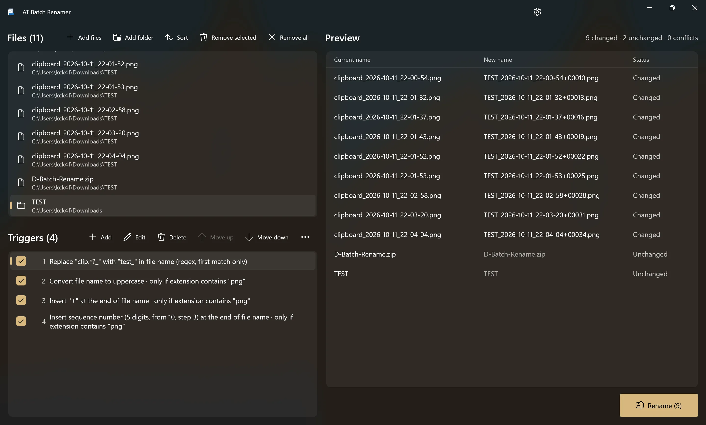

# AT Batch Renamer

🌐 English | [한국어](README.ko.md)

AT Batch Renamer is a Windows app for renaming many files and folders at once.

Rename rules are built as a list of triggers, such as replacing text, adding a number, or converting the extension to lowercase. Triggers are applied from top to bottom, and each trigger receives the name produced by the one before it.

New names can be checked in a live preview before renaming, and the rename can be undone afterward.

## Screenshot

## Highlights

- **Stackable triggers.** Combine replace, insert, and change-case triggers in any order. Reorder them by dragging, and clear a trigger's check box to skip it without deleting it. Trigger lists can be saved to and loaded from `.brtriggers` files.
- **Live preview with conflict checks.** New names are recalculated whenever files or triggers change. Duplicate names, names that already exist, invalid characters, empty names, and reserved names such as `CON` and `NUL` are flagged before renaming.
- **Safe renaming and undo.** Every item is moved to a temporary name before it receives its final name. This makes name swaps (`a.txt` ↔ `b.txt`), chained renames, and case-only changes such as `photo.JPG` → `photo.jpg` possible. A folder and the files inside it can be renamed together. If an item fails, only that item is restored to its original name, and the reason is shown.
- **File Explorer context menu.** Select files or folders, right-click, and choose **Rename with AT Batch Renamer**. The command appears in the main Windows 11 context menu without going through "Show more options", and large selections are passed in full.
- **Regex, sequence numbers, and conditions.** Find text with regular expressions and use captured groups in the replacement. Add sequence numbers with a set number of digits, start number, and step, and restrict a trigger to names that meet a condition.
- **Folder handling.** When folders are added, choose whether to rename the folders themselves, add the files inside them, or add all files including subfolders. The choice can be saved as the default and changed later in Settings.
- **Native WinUI app.** Built with WinUI 3, the latest UI framework for Windows. Because it is not web-based, it uses less memory and starts quickly. Runs natively on x86, x64, and ARM64, including the context menu, and follows the light or dark theme.
- **Localized.** English, Korean, Japanese, Simplified Chinese, and Traditional Chinese.

## Why AT Batch Renamer?

Standard find and replace applies one rule at a time. Tasks that need several steps, such as removing a prefix, adding numbers, and normalizing extensions, must be run in separate passes, and a mistake partway through is hard to undo.

AT Batch Renamer combines multiple rules into a single trigger list and applies them in one run. Results and conflicts can be checked in the preview before renaming, and the run can be undone afterward. Trigger lists can be saved and reused for recurring tasks.

## Trigger actions

| Action          | Description                                                                                                                                                                                                                 |
| --------------- | --------------------------------------------------------------------------------------------------------------------------------------------------------------------------------------------------------------------------- |
| **Replace**     | Replaces the whole name, or specific text within it, with text or a sequence number. Specific text can be matched as plain text or a regular expression, and all matches, only the first, or only the last can be replaced. |
| **Insert**      | Inserts text or a sequence number at the beginning, at the end, or after a given number of characters.                                                                                                                      |
| **Change case** | UPPERCASE, lowercase, Capitalize Each Word, or Sentence case.                                                                                                                                                               |

## Trigger options

- **Apply to.** File name, extension, or both. Folders are treated as having no extension, and names that start with a dot, such as `.gitignore`, are treated entirely as the file name.
- **Regular expressions.** Use `$1`, `$2`, and so on in the replacement text to insert captured groups. Regex matching has a time limit, so a faulty pattern cannot freeze the app.
- **Sequence numbers.** Set the number of digits, the start number, and the step. Numbers only advance for files the trigger actually changes, so conditions do not leave gaps.
- **List order.** Sequence numbers follow the order of the file list. The list can be sorted by name, date modified, date created, size, or extension in ascending or descending order, or rearranged by dragging.
- **Only apply to matching names.** Test the file name, extension, or both with contains, starts with, ends with, is exactly, or a regular expression, and choose whether the trigger applies when the condition matches or when it does not. Conditions are evaluated against the name produced by earlier triggers.
- **Match case.** Can be set separately for find text and for conditions.

## Notes

- Undo applies only to the most recent run and is cleared when the app closes.
- Hidden and system files are skipped when files are added from a folder.
- Display language changes take effect after the app restarts.
- Renaming also changes paths used by shortcuts, scripts, and other apps. Review the preview before renaming.

## License

AT Batch Renamer is licensed under the [MIT License](LICENSE.txt).

## Author

Created by [Howon Lee (airtaxi)](https://github.com/airtaxi).
